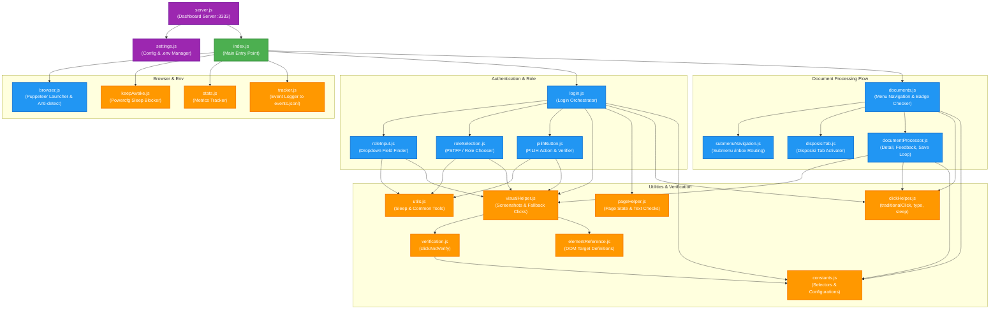
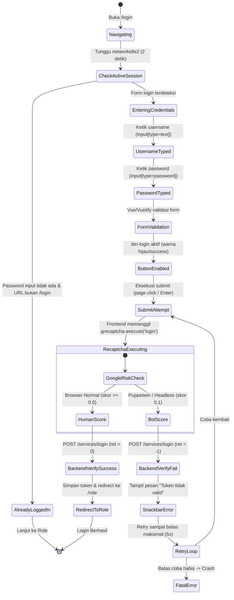

# SIDIA Automation — Code Mapping & Architecture Graph

Dokumen ini menyediakan pemetaan visual lengkap (graph/diagram) untuk seluruh modul, fungsi, dan alur eksekusi pada proyek **SIDIA Clicker (Automation)**.

---

## 1. Modul Dependency Graph (Peta Ketergantungan Modul)

Graph ini memetakan bagaimana modul-modul di dalam proyek saling terhubung dan bergantung satu sama lain:

---

## 2. End-to-End Execution Flow (Alur Eksekusi Sistem)

Diagram alir urutan proses otomasi dari mulai dijalankan sampai selesai:

```mermaid
flowchart TD
    Start([Mulai: npm start / start.bat]) --> InitEnv[Baca konfigurasi .env & validasi kredensial]
    InitEnv --> PreventSleep[keepAwake.js: Blokir sleep Windows]
    PreventSleep --> LaunchBr[browser.js: Launch Chromium / Chrome]
    LaunchBr --> CreatePg[Setup anti-detection, Viewport, UserAgent]

    CreatePg --> Step1{Sesi Browser Masih Aktif?}
    Step1 -- Ya (Sudah login) --> Step2[Lewati login, langsung ke cek Role]
    Step1 -- Tidak --> NavLogin[Buka https://sidia.bpjsketenagakerjaan.go.id/login/]

    NavLogin --> FillCreds[Isi Username & Password]
    FillCreds --> WaitBtn[Tunggu tombol LOGIN enabled]
    WaitBtn --> SubmitLogin[Klik Tombol LOGIN / Submit]
    SubmitLogin --> CaptchaCheck{Hasil reCAPTCHA & Respon Server?}

    CaptchaCheck -- "Token tidak valid" / Error --> RetryLogin{Coba lagi? < 5x}
    RetryLogin -- Ya --> SubmitLogin
    RetryLogin -- Tidak --> FailExit([Error: Gagal Login])

    CaptchaCheck -- Sukses / Redirect --> CheckRolePage[Deteksi Halaman /role]

    CheckRolePage --> RoleNeeded{Sudah di Dashboard atau Butuh Pilih Role?}
    RoleNeeded -- Sudah di Dashboard --> Step3[Buka Naskah Masuk]
    RoleNeeded -- Butuh Role --> SelectRoleField[roleInput.js: Klik field Role]
    SelectRoleField --> ChoosePSTFF[roleSelection.js: Pilih role PSTFF / pertama]
    ChoosePSTFF --> ClickPILIH[pilihButton.js: Klik PILIH & verifikasi redirect]
    ClickPILIH --> Step3

    Step3 --> ScanBadges[documents.js: Baca badge jumlah naskah di tiap submenu]
    ScanBadges --> HasDocs{Ada submenu dengan badge > 0?}
    HasDocs -- Tidak Ada --> DoneStats[Rekap statistik]
    HasDocs -- Ada Dokumen --> ClickSubmenu[submenuNavigation.js: Klik submenu]
    ClickSubmenu --> SwitchTab[disposisiTab.js: Klik Tab Disposisi]
    SwitchTab --> LoopDoc[documentProcessor.js: Loop klik LIHAT]

    LoopDoc --> FillFeedback[Isi feedback: 'noted' / teks config]
    FillFeedback --> SaveFeedback[Klik SIMPAN & Konfirmasi popup]
    SaveFeedback --> NextDoc{Masih ada baris dokumen?}
    NextDoc -- Ya --> LoopDoc
    NextDoc -- Tidak --> NextSubmenu{Masih ada submenu lain?}
    NextSubmenu -- Ya --> ScanBadges
    NextSubmenu -- Tidak --> DoneStats

    DoneStats --> RestoreSleep[Pulihkan sleep setting Windows]
    RestoreSleep --> CloseBrowser[Tutup Browser & Tampilkan Summary]
    CloseBrowser --> End([Selesai])
```

---

## 3. Detail State Diagram: Modul Login & Investigasi Kendala

State machine yang menggambarkan bagaimana modul `login.js` bekerja serta titik kritis terjadinya kegagalan:

---

## 4. Struktur File & Tanggung Jawab

| File | Baris | Peran / Tanggung Jawab Utama |
|---|---|---|
| `index.js` | ~157 | Entry point eksekusi alur utama, integrasi error handling dan sleep prevention. |
| `browser.js` | ~105 | Pengaturan peluncuran Puppeteer, user agent, profil browser, dan anti-bot hooks. |
| `login.js` | ~503 | Koordinator autentikasi, pengisian form login, penanganan reCAPTCHA & retry. |
| `roleInput.js` | ~200 | Mencari elemen input dropdown pilihan role di halaman `/role`. |
| `roleSelection.js` | ~269 | Memilih opsi role (prioritas `PSTFF - Pelaksana/Staff`) dari list Vuetify. |
| `pilihButton.js` | ~130 | Memastikan tombol PILIH diklik dan halaman berpindah dari `/role`. |
| `documents.js` | ~440 | Navigasi menu utama Naskah Masuk dan pemindaian badge dokumen. |
| `submenuNavigation.js` | ~161 | Navigasi ke masing-masing submenu dokumen `/inbox?f=...`. |
| `disposisiTab.js` | ~272 | Berpindah ke tab `DISPOSISI` dan memastikan tabel dokumen tampil. |
| `documentProcessor.js` | ~654 | Pemrosesan baris dokumen: tombol LIHAT, input feedback, simpan, dan modal SweetAlert. |
| `constants.js` | ~131 | Koleksi selector DOM (CSS), timeout timing, dan regex pattern. |
| `clickHelper.js` | ~219 | Fungsi pembantu simulasi klik dan ketik bertahap (`traditionalType`). |
| `visualHelper.js` | ~772 | Pengambilan screenshot, snapshot struktur DOM saat error, dan fallback klik. |
| `server.js` | ~230 | Web server dashboard monitoring berbasis Express/HTTP di port 3333. |
| `settings.js` | ~101 | Manajemen pembacaan dan pembaruan file `.env` dari web dashboard. |
